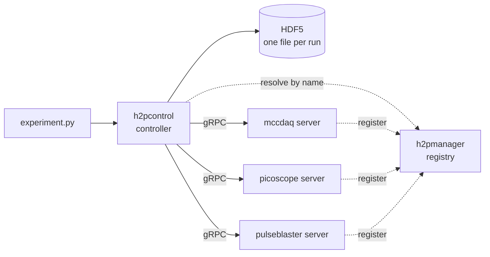

# h2pcontrol

A distributed experiment control system for the lab.



!!! note "Documentation in progress"

    This site is newly set up and most pages are still to be written. For now the
    [README](https://github.com/torbenfreise/h2pcontrol#readme) is the most complete
    starting point.

## The pieces

| Component | Role | Language |
|---|---|---|
| [Controller](https://github.com/torbenfreise/h2pcontrol) | Experiment framework and GUI — documented on this site | Python |
| [h2pmanager](https://github.com/torbenfreise/h2pcontrol-manager) | Service registry, default `localhost:50051` | Go |
| [h2pcontrol-protos](https://github.com/torbenfreise/h2pcontrol-protos) | Service definitions, published to the [BSR](https://buf.build/beyer-labs/h2pcontrol) | Protobuf |
| [h2pcontrol-sdk](https://github.com/torbenfreise/h2pcontrol-sdk) | Shared client and server SDK | Python |
| [server-template](https://github.com/torbenfreise/h2pcontrol-server-template) | Starting point for a new device server | Python |

## Where to start

<div class="grid cards" markdown>

-   :material-flask: **[Getting started](getting-started/index.md)**

-   :material-file-code: **[Writing experiments](guide/index.md)**

-   :material-book-open-variant: **[API reference](reference/index.md)**

-   :material-sitemap: **[Architecture](internals/architecture.md)**

</div>

## Quickstart

```bash
uvx --index https://buf.build/gen/python \
  --from git+https://github.com/torbenfreise/h2pcontrol \
  h2pcontrol init my-experiments

cd my-experiments
uv sync
uv run h2pcontrol
```

This scaffolds a project with a runnable starter experiment and launches the GUI. The starter
needs no hardware.
