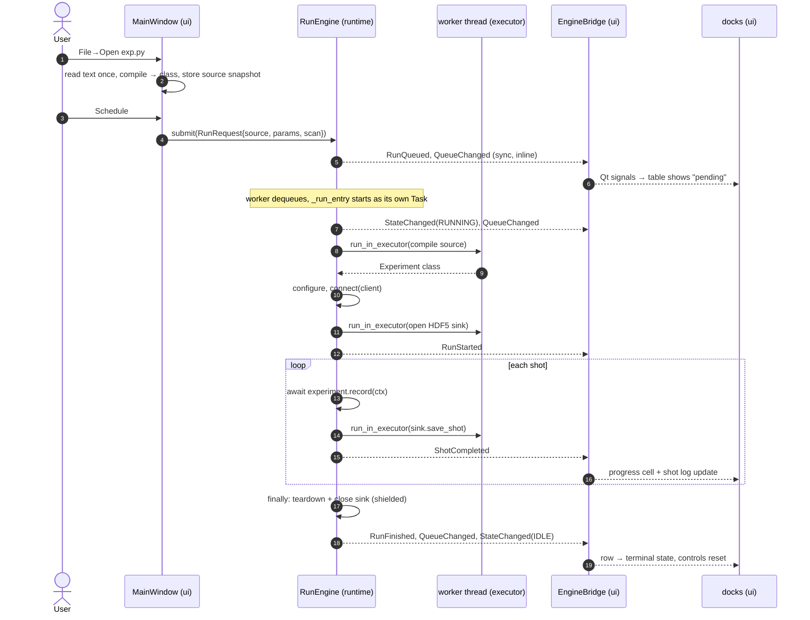

# h2pcontrol — control software architecture

This document explains how the **controller** (the GUI + experiment-execution
framework) is put together: its layers, the run engine, and — the part that most
often trips people up — how the PyQt/asyncio event loop works and how the engine
lives inside it.

It is a companion to `CLAUDE.md` (the terse rules of the repo). Where this
document and the code disagree about *current* behaviour, trust the code.

!!! warning "Known stale sections"

    This page predates several refactors and has not yet been revised. Until it is,
    treat the following as out of date:

    - §2.2 documents `runtime/provenance.py`; that module is now `runtime/run_metadata.py`.
    - §2.1 says `shot()` produces a `pandas.DataFrame`. It returns `Sequence[Results]`;
      the `@final` `record()` is what produces the DataFrame.
    - §2.1 lists `connect()` as a user hook. It is `@final` — the user hooks are
      `setup()`, `teardown()` and `metadata()`.
    - §2.1 predates `framework/results.py`, `framework/views.py` and `framework/stubs.py`,
      and so omits the `result()`, `view()` and `service_stub()` declarations entirely.
    - References to `PHASE*.md` planning notes are dangling; no such file exists in the
      repository or its history.

---

## 1. The big picture

The controller is one process with three layers. Dependencies point **downward
only** — UI depends on runtime, runtime depends on framework, and nothing points
back up.

```
┌─────────────────────────────────────────────────────────────┐
│  ui/            Qt adapter (PySide6 widgets, EngineBridge)    │  ← may import runtime + framework
│                 main_window, schedule_dock, log_dock, …       │
├─────────────────────────────────────────────────────────────┤
│  runtime/       application layer (asyncio-native)            │  ← may import framework + h2pcontrol.sdk
│                 RunEngine, events, spec, session, store       │
├─────────────────────────────────────────────────────────────┤
│  framework/     domain (pure Python, stdlib + numpy/pandas)   │  ← imports nothing above
│                 Experiment, ParamSpec, Scan / Axis            │
└─────────────────────────────────────────────────────────────┘
```

The enforced rules (checked by review, not yet by tooling):

| Layer | May import | Must **not** import | Why |
|-------|-----------|---------------------|-----|
| `framework/` | stdlib, numpy, pandas | grpc, Qt, asyncio I/O | It is the domain model. It must be testable and reusable with zero infrastructure. |
| `runtime/` | `framework/`, `h2pcontrol.sdk`, asyncio | **Qt** | It is the application logic. Keeping Qt out means the engine can be driven by tests, a CLI, or a different UI. |
| `ui/` | `runtime/`, `framework/`, Qt | — | It is a thin adapter. No experiment logic lives here. |

The single most important consequence: **`runtime/` never imports Qt.** The
engine does not know a GUI exists. It publishes plain Python events; a thin
adapter (`EngineBridge`) is the *only* thing that turns those into Qt signals.
That boundary is what makes the concurrency model tractable (§4).

---

## 2. The layers in detail

### 2.1 `framework/` — the domain

- **`Experiment`** (`framework/experiment.py`) — the base class a user subclasses.
  It declares parameters, an `async shot(ctx)` that produces one row of data as a
  `pandas.DataFrame`, and optional `connect()` / `teardown()` hooks. A metaclass
  hook (`__init_subclass__`) collects parameter descriptors, collects device
  "stubs", and wraps `shot()` so every returned frame automatically gets the
  current parameter values attached under a `params` column group.
- **`ParamSpec` / `param()`** (`framework/parameters.py`) — a typed *data
  descriptor*. `MyExp.voltage` (class access) returns the spec itself (used to
  build scans and the parameter panel); `self.voltage` (instance access) returns
  the validated value. Assignment goes through `validate()`, which enforces
  `min`/`max`/`choices`/dtype.
- **`Scan` / `Axis`** (`framework/scan.py`) — an N-dimensional sweep over one or
  more parameters, producing a sequence of points (dicts of `{param: value}`).

Nothing here does I/O, talks to the network, or knows about Qt or asyncio.

### 2.2 `runtime/` — the application layer

- **`RunEngine`** (`runtime/engine.py`) — the heart of the system. A queue-first,
  event-driven executor. Covered in depth in §3.
- **`events.py`** — the typed event vocabulary (`RunQueued`, `RunStarted`,
  `ShotCompleted`, `RunFinished`, `QueueChanged`, `StateChanged`) plus the state
  enums (`EngineState`, `EntryState`). The module docstring is the canonical
  event-ordering contract.
- **`spec.py`** — `RunRequest` and the serializable scan DTOs (`ScanSpec`,
  `AxisSpec`). A `RunRequest` is an immutable snapshot of *everything* needed to
  execute a run: the experiment **source text**, parameter values, and scan.
- **`session.py`** — `Session` owns the SDK `Client` (the connection to the
  device manager) and knows how to turn experiment source text into an
  `Experiment` subclass (`load_experiment_from_source`).
- **`store.py`** — `RunStore`, one HDF5 file per run. Scalars go into a `/data`
  table (schema frozen on the first shot), arrays/traces into `/traces/shot_NNNNN`.
- **`provenance.py`** — collects HDF5 root attributes (package/python version,
  the byte-exact experiment source, git commit/dirty flag).

### 2.3 `ui/` — the Qt adapter

- **`main_window.py`** — wires everything together, owns the `Session` and the
  `RunEngine`, handles File→Open and Schedule, and routes engine events to
  widgets.
- **`experiment_panel.py`** — renders one row per parameter; each row can be a
  fixed value or a scan axis.
- **`run_controls.py`** — the run-count pickers and the Schedule button. Adapts
  to the panel's `scan_changed` signal: it always shows a "Repeats [∞]" knob
  (total shots without a scan, sweeps over one with it), and additionally reveals
  "Repeats per point" (averaging) only when a scan is configured.
- **`schedule_dock.py`** — the run queue as a table, with a per-row context menu
  (Cancel / Stop / Force terminate) and "Clear completed".
- **`log_dock.py`** — an aggregated, filterable log table (controller +
  experiment + manager logs), fed by the runtime `LogAggregator`. Multiselect
  source/level filters, substring search, follow-tail.
- **`engine_bridge.py`** — the *bridge* (§4.3). Subscribes to the engine and
  re-emits each event as a Qt signal.

---

## 3. The RunEngine

The engine executes runs one at a time from a FIFO queue and reports progress by
emitting events. Its lifecycle is `create → submit(request)* → aclose()`.

### 3.1 Internal structure

```
submit(request) ──► _entries[run_id] = _Entry(QUEUED)     (the durable record)
                └─► _pending.put(run_id)                  (the work queue)
                └─► starts the worker task on first submit

_worker_loop():                       one long-lived asyncio.Task
    while True:
        run_id = await _pending.get()
        entry  = _entries[run_id]
        if entry.state != QUEUED: continue        # was cancelled before dequeue
        _current_task = ensure_future(_run_entry(entry))   # a fresh Task per run
        await _current_task
```

Two collections, two different jobs:

- **`_entries: dict[RunId, _Entry]`** — the durable history. Entries are added on
  submit and **never auto-removed**. When a run finishes it stays as a terminal
  history row (`COMPLETED` / `FAILED` / `STOPPED` / `CANCELLED`). The only removal
  path is the explicit `clear_finished()`.
- **`_pending: asyncio.Queue[RunId]`** — the pull queue the worker drains.

Each run executes inside its **own** `asyncio.Task` (`_current_task`), separate
from the worker task. This isolation is what makes a hard-cancel possible: we can
`_current_task.cancel()` to tear down a stuck run without killing the worker that
must go on to run the next entry.

### 3.2 One run, step by step (`_run_entry`)

1. **Compile** the source snapshot into an `Experiment` class (in a worker
   thread — see §4.4).
2. **Configure** — instantiate, set parameter values (an unknown-parameter guard
   runs before any device work), resolve the scan.
3. **Connect** to devices (`experiment.connect(client)`).
4. **Create the sink** (`RunStore`, in a worker thread).
5. **Emit `RunStarted`**, then run the **shot loop**: for each scan point × repeat,
   `await experiment.record(ctx)`, save it, emit `ShotCompleted`. After each shot,
   check the soft-stop flag.
6. **`finally`** — always run `teardown()` and close the sink (shielded so a
   second cancellation can't skip them), emit `RunFinished`, then `StateChanged`.

Failures are classified by *stage* so the log/UI can tell them apart:
`load failed:` / `invalid parameters:` / `connect failed:` / `shot failed:` /
`storage failed:`.

### 3.3 Stop semantics

- **Soft stop** (`stop_current()`) — sets a flag; the current shot finishes, the
  loop checks the flag and ends the run with outcome `STOPPED`. Data already
  taken is preserved.
- **Hard stop** (`stop_current(hard=True)`) — cancels `_current_task`. The
  `CancelledError` unwinds the run; `_run_entry` **swallows** it (outcome
  `STOPPED`, cleanup still runs) rather than re-raising, so the worker survives.
- **`aclose()`** — cancels the current run and the worker, awaiting both. Because
  `_run_entry` swallows its own cancellation and shields cleanup, shutdown with
  queued entries never deadlocks and never leaves a file half-open.

### 3.4 Source-snapshot binding

The experiment file is read from disk **exactly once**, at File→Open. That call
captures `(path, source_text, class)`: the class drives the parameter panel, and
the *text* travels inside every `RunRequest`. At dequeue the engine compiles
`request.source` — it never re-reads the file.

Consequences (all intended):

- Editing the file on disk has **no effect** until you File→Open again.
- Two queued runs can carry two different snapshots of the same file, and each
  runs its own code.
- The HDF5 `experiment_source` attribute is byte-identical to the code that ran.

---

## 4. The event loop: how Qt and asyncio become one

This is the part that makes the interaction between the GUI and the engine work,
and it is worth understanding precisely.

### 4.1 Two loops, normally

A normal Qt program spins the **Qt event loop** (`app.exec()`): it pulls events
off a queue — mouse clicks, repaints, timers, queued signal deliveries — and
dispatches each to a handler, forever, on the main thread.

A normal asyncio program spins the **asyncio event loop**
(`loop.run_forever()`): it pulls ready callbacks and resumes suspended
coroutines at their `await` points, forever, on one thread.

Each is a single-threaded "pull one thing, run it to completion, repeat" loop.
The problem: a GUI app that also wants `async`/`await` seemingly needs *both*
loops running, and neither yields to the other.

### 4.2 qasync: one loop wearing both hats

`qasync` resolves this by implementing the **asyncio event-loop interface on top
of the Qt event loop**. `qasync.QEventLoop(app)` is a real `asyncio`
`AbstractEventLoop`, but every time asyncio wants to "schedule a callback" or
"wait for a timer", qasync expresses that using Qt's own mechanisms (Qt timers,
socket notifiers, and a queued call into the Qt loop). Qt is the one true loop;
asyncio rides on it.

```python
# app.py
app  = QApplication(sys.argv)
loop = qasync.QEventLoop(app)     # an asyncio loop backed by Qt
asyncio.set_event_loop(loop)      # asyncio.get_running_loop() now returns it
with loop:
    loop.run_forever()            # runs Qt's loop; also services asyncio
```

The result: **one thread, one loop.** It interleaves, on the same call stack:

- Qt work: painting, input, signal/slot delivery, `QTimer` callbacks;
- asyncio work: resuming coroutines at `await`, running `Task`s, firing
  `loop.call_soon` callbacks.

An `await` inside a coroutine yields control back to this shared loop, which is
then free to paint the window or deliver a click before resuming the coroutine.
That is how the engine can run shots "in the background" while the GUI stays
responsive — there is no background *thread*, just a coroutine that keeps
yielding at each `await`.

### 4.3 Why the engine can emit events with a plain function call

Because everything runs on the **one** loop/thread, there is no thread boundary
between the engine and the widgets. The engine calls its subscribers
*synchronously*:

```python
# engine.py
def _emit(self, event):
    for cb in self._subscribers:
        cb(event)          # direct call, same thread, same stack
```

`EngineBridge` is subscribed, so `cb(event)` runs `bridge._dispatch(event)`,
which does `self.run_started.emit(event)`. And because the emitter and the
receiver live on the same thread, Qt delivers that signal with a **direct**
connection — the slot (`MainWindow._on_run_started`) runs immediately, inline,
before `emit()` returns.

```
engine._run_entry (coroutine, on the loop)
   └─ self._emit(RunStarted)
        └─ bridge._dispatch(RunStarted)
             └─ self.run_started.emit(event)      Qt direct connection
                  └─ MainWindow._on_run_started(event)   ← runs right here
                       └─ logger.info("Run … started")    ← reaches the log dock
   (control returns all the way back up, run loop continues)
```

No `QThread`, no `Qt.QueuedConnection`, no locks. The bridge exists purely to
keep Qt out of `runtime/` (§1): the engine speaks plain dataclasses; the bridge
is the single file that knows both vocabularies.

**There is exactly one production subscriber.** The engine's `_subscribers` is a
list and it *supports* any number, but the whole application registers a single
callback — `EngineBridge._dispatch` (the only `engine.subscribe(...)` call in
`src/`). The bridge is the sole fan-out point: the widgets subscribe to the
bridge's **Qt signals**, not to the engine. So `ScheduleDock` listens for
`queue_changed` / `shot_completed` / `state_changed`, `MainWindow` for
`run_started` / `shot_completed` / `run_finished` / `state_changed`, and the
"multiple consumers" all sit one layer *below* the engine. (Tests are the only
place that attach extra engine subscribers.) `_emit` invokes subscribers in
registration order and wraps each in `try/except`, so a raising subscriber is
logged and cannot break the others or the run.

### 4.4 The rule that keeps it all working: never block the loop

Since one thread does *everything*, any synchronous call that takes time — a
blocking network read, a big HDF5 write, `time.sleep`, a `compile()` of a large
file — freezes the **entire GUI** for its whole duration. The loop can't paint or
respond until the call returns.

So the codebase follows two disciplines:

1. **Device and framework work is `async`.** `shot()` and `connect()` are
   coroutines; they `await`, yielding the loop between operations.

2. **Unavoidably-blocking work is pushed to a thread pool** via
   `loop.run_in_executor(None, fn, ...)`. In the engine this wraps:
   - compiling the experiment source (`loader`),
   - creating the sink (`sink_factory` → opens the HDF5 file),
   - every `sink.save_shot(...)` and `sink.close()`.

   `run_in_executor` runs `fn` on a background thread and gives back an awaitable;
   the coroutine `await`s it, so the loop stays free while the disk write happens.
   When the worker sets the result, asyncio wakes the awaiting coroutine **back on
   the loop thread**, so no shared-state locking is needed on the engine side. The
   flip side: whatever you hand the executor must not touch Qt widgets or engine
   internals — and nothing does; the callbacks take plain args and return plain
   data.

#### The executor itself

`None` means "the loop's default executor", and here the loop is qasync's — which
does **not** use the stdlib `ThreadPoolExecutor`. On the first
`run_in_executor(None, …)` qasync lazily creates a **`QThreadExecutor`**: a fixed
pool of **10 `QThread` workers** (`max_workers=10`) draining an unbounded
`queue.Queue`. It is owned by the loop and shut down (all workers joined) when the
loop closes. Nothing in this repo constructs or manages it — the engine just
borrows the loop's default.

In practice the pool is nowhere near its limit: the engine runs one entry at a
time and `await`s each executor call before issuing the next, so it has **at most
one job in flight**. Nothing else in the controller uses the executor (the manager
ping is async gRPC, not a thread). So the 10 workers are almost all idle.

**What if more than 10 executor jobs are submitted at once?** Submissions past 10
do not error and do not block the caller — `submit()` just appends to the
unbounded queue and returns a future immediately. Workers pull jobs FIFO as they
free up, so extra work simply waits its turn; the only effect is added latency for
the awaiting coroutines. The real hazard of a fixed pool is **starvation**: if a
callback blocks *forever* on a worker (e.g. a synchronous, hung device call run
inside the executor), it occupies that thread permanently — 10 such stuck jobs
would exhaust the pool and stall every later `run_in_executor`, including the
engine's own saves. The defence is the discipline above: keep genuinely
long-lived / blocking device I/O in `async` code (which yields the loop) and use
the executor only for short, self-terminating CPU/disk work.

There is a corollary for **event subscribers**: because `_emit` calls them
inline on the loop, a subscriber must return quickly and must not spin a nested
loop. That is exactly why `MainWindow` defers its failure dialog:

```python
# a modal dialog runs its own event loop; opening one *inside* _emit would
# stack a nested loop under the engine's call stack. Defer it instead:
QTimer.singleShot(0, lambda: QMessageBox.warning(self, "Run Failed", message))
```

`QTimer.singleShot(0, …)` posts the dialog to run on the *next* loop turn, after
`_emit` has unwound — the engine keeps moving, and the modal opens cleanly.

### 4.5 Spawning and owning async work from the GUI

GUI handlers are synchronous Qt slots, so when one needs to start async work it
*schedules* a task rather than awaiting:

```python
def _spawn(self, coro):
    task = asyncio.ensure_future(coro)   # schedule on the shared loop
    self._bg_tasks.add(task)             # keep a strong ref (or it may be GC'd)
    task.add_done_callback(self._bg_tasks.discard)
```

This is used for the periodic manager ping (driven by a `QTimer`), for applying
settings, and for the fire-and-forget `engine.aclose()` on window close. Holding
the reference matters: asyncio only keeps a *weak* reference to a bare task, so a
task you don't retain can be garbage-collected mid-flight.

---

## 5. End-to-end: the life of a run

Putting the layers and the loop together, here is what happens from click to file.



Every arrow marked "sync/inline" happens on the one loop thread; every
`run_in_executor` hop is the engine deliberately stepping off the loop so the GUI
never freezes.

### The event-ordering contract

Subscribers (and tests) rely on this exact order, which the engine guarantees:

```
per submit:   RunQueued → QueueChanged
per run:      StateChanged(RUNNING) → QueueChanged → RunStarted
              → ShotCompleted*  → RunFinished → QueueChanged
              → StateChanged(IDLE)      # skipped if another run is already pending
```

The `IDLE` emit is suppressed between back-to-back runs (when `_pending` is
non-empty) so the UI doesn't flicker `RUNNING → IDLE → RUNNING` on every dequeue.

---

## 6. Concurrency model — summary

| Concern | Mechanism |
|---------|-----------|
| GUI + async on one thread | `qasync.QEventLoop` — asyncio implemented on Qt's loop |
| Engine ↔ GUI communication | one subscriber (`EngineBridge`) → Qt signals (direct connection); widgets listen to the bridge |
| One run at a time | single `_worker_loop` task draining `_pending` |
| Isolating a run for hard-cancel | each run is its own `_current_task` |
| Blocking I/O (compile, HDF5) | `loop.run_in_executor(None, …)` → qasync `QThreadExecutor`, 10 QThreads, owned by the loop |
| Soft stop | a flag checked between shots → `STOPPED`, data kept |
| Hard stop / shutdown | cancel the run task; `_run_entry` swallows the cancel; cleanup is shielded |
| Queue history | entries persist as terminal rows; `clear_finished()` is the only removal |
| Reproducibility | source-snapshot binding: file read once, text carried in every `RunRequest` |

The throughline: **keep `runtime/` free of Qt, keep the loop unblocked, and let
one thread do everything.** Those three choices are what make the interaction
between the GUI and the engine simple enough to reason about.
